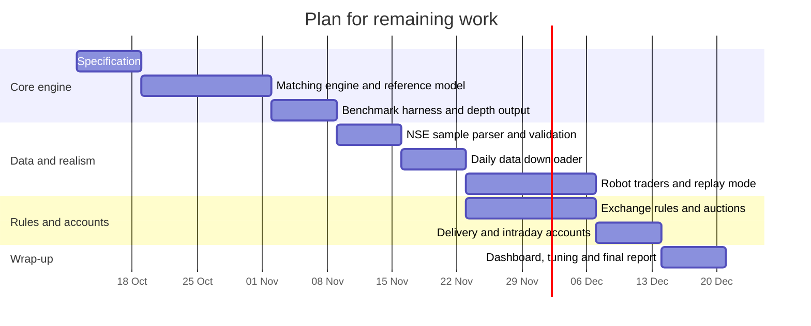

# High-Performance Order Book and Matching Engine Simulator for the Indian Equity Cash Market

**Project progress report: literature survey, documentation and timeline**

| | |
|---|---|
| Institution | [fill in] |
| Department / Course | [fill in] |
| Team members | [fill in] |
| Project guide | [fill in] |
| Report date | 11 October 2026 |
| Repository | <https://github.com/Athang69/OrderBook-Matching-Engine> |

---

## Abstract

Electronic stock exchanges match buyers and sellers through a limit order book governed by price-time priority. This project builds a simulator of the Indian equity cash market (delivery and intraday trading) consisting of an order book, a matching engine, and a price-level market depth view showing the five best bids and asks. The engine is written in C++ with performance as a primary goal. Because operating a real trading venue and redistributing live exchange data are both restricted in India, the system is a simulator: it uses virtual participants, free exchange data from the previous trading day, and synthetic order flow. This report presents the literature survey, the regulatory and data feasibility studies, the proposed design, the work completed as of 11 October 2026, and the plan for the remaining work.

---

## 1. Introduction

### 1.1 Background

Modern exchanges such as the National Stock Exchange of India (NSE) are order-driven. Participants submit buy and sell orders, the exchange stores unmatched orders in a limit order book, and a matching engine pairs compatible orders. The rule that decides who trades first is price-time priority: the best price is served first, and among orders at the same price, the earliest is served first.

The matching engine is the performance-critical core of an exchange. It must process a very large number of order entries, modifications and cancellations with low and predictable delay, while remaining exactly correct and reproducible.

### 1.2 Motivation

- Matching engines combine data structure design, systems programming and financial market rules, which makes them a strong vehicle for studying high-performance computing in a real domain.
- Published open-source engines and simulators are mostly modelled on United States, South African or cryptocurrency venues. The Indian market has its own rules: tick sizes that depend on price, daily price bands, an opening call auction, and a closing auction introduced in August 2026.
- Order-level data for Indian stocks is not freely available, so realistic experimentation needs a simulator.

### 1.3 Problem statement

To design and implement a high-performance limit order book and matching engine that follows the trading rules of the Indian equity cash market, to drive it with previous-day market data and synthetic order flow, and to evaluate its correctness and performance.

### 1.4 Objectives

1. Implement a matching engine with strict price-time priority supporting limit, market and immediate-or-cancel orders, with modification and cancellation.
2. Provide a price-level view of the book showing the five best bid and ask levels per stock.
3. Model Indian cash market rules: tick sizes, price bands, opening and closing auctions, and stop-loss orders.
4. Model delivery and intraday trading for virtual accounts, including margin and automatic square-off.
5. Generate realistic order flow from previous-day exchange data without paid data sources.
6. Validate the engine against real exchange order and trade records.
7. Measure throughput and latency, and optimise the design accordingly.

### 1.5 Scope and limitations

| In scope | Out of scope |
|---|---|
| NSE cash segment, EQ series | Futures, options, currency and commodity segments |
| Delivery (CNC) and intraday (MIS) trading | Real-money trading and real user onboarding |
| Previous-day and older data | Live market data |
| Free data sources | Paid data feeds |
| Virtual participants and robot traders | Network co-location and hardware acceleration |

The system is a simulator for study and evaluation. It is not a trading venue.

---

## 2. Literature survey

The survey is organised into six themes. Section 2.7 summarises each work and its relevance; numbers in square brackets refer to the references in section 10.

### 2.1 Market microstructure foundations

Harris [1] and O'Hara [2] give the standard treatments of how trading mechanisms work, including order types, order precedence rules and the distinction between continuous and call markets. Madhavan [3] surveys the field. Glosten and Milgrom [4] and Kyle [5] explain the bid-ask spread and price impact as consequences of trading against better-informed participants. Glosten [6] analyses the electronic open limit order book as a market design and argues that it is robust against competing designs. These works establish the vocabulary and the rules that our engine must implement.

### 2.2 Limit order book theory and empirical behaviour

Parlour [7] and Foucault [8] model the choice between placing a limit order and a market order. Both show that the state of the book matters, and Parlour in particular shows that a place in the queue has value under time priority. Biais, Hillion and Spatt [9] study the Paris Bourse and find that order flow depends on the state of the book: traders supply liquidity when the spread is wide and consume it when the spread is narrow. Bouchaud, Mézard and Potters [10] report statistical regularities of order books, including the distribution of limit order prices around the current price. Gould et al. [11] survey the empirical facts and the models, and point out the distance between the two. These findings guide what a realistic synthetic book should look like.

### 2.3 Order flow modelling and market simulation

Gode and Sunder [12] show that traders who submit random orders within a budget constraint still produce efficient outcomes in a double auction, which suggests that market rules explain much of market behaviour. Smith et al. [13] build a statistical theory of the continuous double auction from random order placement and cancellation, and Farmer, Patelli and Zovko [14] show that such a model explains much of the variation in spreads and price diffusion in London Stock Exchange data. Cont, Stoikov and Talreja [15] model the book as a system of queues with Poisson arrivals. Huang, Lehalle and Rosenbaum [16] make arrival rates depend on queue sizes. Bacry, Mastromatteo and Muzy [17] review Hawkes processes, which capture the clustering of orders in time.

On the systems side, ABIDES [18] is an open-source agent-based simulator with an exchange agent and many trading agents, and El Karmi [19] describes a deterministic C++ order book engine driven by Hawkes order flow. These works define the options for our order generator, from simple random flow to self-exciting models.

### 2.4 Matching engine design and low-latency systems

Thompson et al. [20] introduce the Disruptor, a lock-free ring buffer built around a single writer and cache-friendly memory layout, developed for the LMAX exchange. Fowler [21] describes the LMAX architecture, in which a single-threaded business logic processor fed by such buffers is reported to handle 6 million orders per second, with state recovered by replaying a journal of inputs. CoinTossX [22] is an open-source low-latency matching engine written in Java, using binary messages over UDP, built to simulate the Johannesburg Stock Exchange. Leber, Geib and Litz [23] and Lockwood et al. [24] move market data processing into FPGA hardware to reduce latency. Hasbrouck and Saar [25] measure low-latency activity and find that it is associated with narrower spreads, greater depth and lower short-term volatility. Budish, Cramton and Shim [26] argue that continuous-time matching creates a race for speed and propose frequent batch auctions.

The design lessons we take from this theme are single-threaded deterministic matching, lock-free message passing, pre-allocated memory, binary message formats, and recovery by replay.

### 2.5 Call auctions at the open and the close

Madhavan [27] compares continuous and periodic trading mechanisms and shows that periodic auctions are more robust when information is unevenly distributed. Economides and Schwartz [28] argue for electronic call auctions alongside continuous trading. Pagano and Schwartz [29] find that introducing a closing call auction at the Paris Bourse lowered execution costs and improved price discovery. These works explain why exchanges open and close with auctions, which our simulator must implement.

### 2.6 Studies of the Indian market

Camilleri and Green [30] study the NSE's suspension of its opening and closing call auctions in 1999 and conclude that such auctions do not necessarily improve trading in a less liquid emerging market. Agarwalla, Jacob and Pandey [31] study the re-introduction of the opening call auction at NSE and find that it attracts little volume and gives only a modest improvement in price discovery. Aggarwal and Thomas [32] use the introduction of co-location at NSE to study the causal effect of algorithmic trading on market quality. Together they show that auction design and speed are open research questions in the Indian market specifically.

On data, LOBSTER [33] reconstructs order books from NASDAQ message data for academic use, and Ntakaris et al. [34] publish a benchmark order book dataset for five Nasdaq Nordic stocks over ten trading days. We found no comparable open dataset for Indian equities.

### 2.7 Summary of surveyed work

| Ref | Work | Key contribution | Relevance to this project |
|---|---|---|---|
| [1] | Harris (2003) | Practitioner text on trading mechanisms and order precedence rules | Defines the rule set the engine implements |
| [2] | O'Hara (1995) | Theoretical foundations of market microstructure | Background theory |
| [3] | Madhavan (2000) | Survey of microstructure research | Map of the field |
| [4] | Glosten and Milgrom (1985) | Spread arises from informed trading | Why spreads exist in a simulated book |
| [5] | Kyle (1985) | Price impact and market depth | Interpreting depth in the book |
| [6] | Glosten (1994) | Analysis of the electronic open limit order book | Justifies the order book design |
| [7] | Parlour (1998) | Order choice depends on queue lengths | Importance of time priority and queue position |
| [8] | Foucault (1999) | Limit versus market order choice under volatility | Order mix for robot traders |
| [9] | Biais, Hillion and Spatt (1995) | Order flow depends on the state of the book | Realism target for synthetic flow |
| [10] | Bouchaud, Mézard and Potters (2002) | Statistical properties of order books | Where to place synthetic limit orders |
| [11] | Gould et al. (2013) | Survey of order book facts and models | Checklist of stylised facts |
| [12] | Gode and Sunder (1993) | Zero-intelligence traders | Simplest robot trader model |
| [13] | Smith et al. (2003) | Statistical theory of the continuous double auction | Baseline order flow generator |
| [14] | Farmer, Patelli and Zovko (2005) | Zero-intelligence model tested on real data | Evidence the baseline is reasonable |
| [15] | Cont, Stoikov and Talreja (2010) | Queueing model of the order book | Arrival and cancellation rates |
| [16] | Huang, Lehalle and Rosenbaum (2015) | Queue-reactive model | State-dependent order flow |
| [17] | Bacry, Mastromatteo and Muzy (2015) | Hawkes processes in finance | Clustered order arrivals (future work) |
| [18] | Byrd, Hybinette and Balch (2020) | ABIDES agent-based market simulator | Reference simulator architecture |
| [19] | El Karmi (2025) | Deterministic C++ book with Hawkes flow | Closest related system |
| [20] | Thompson et al. (2011) | Disruptor lock-free ring buffer | Message passing between threads |
| [21] | Fowler (2011) | LMAX architecture | Single-threaded core, journal and replay |
| [22] | Jericevich, Sing and Gebbie (2021) | CoinTossX open-source matching engine | Comparable engine for another market |
| [23] | Leber, Geib and Litz (2011) | FPGA acceleration of trading systems | Hardware direction, outside our scope |
| [24] | Lockwood et al. (2012) | FPGA library for low-latency trading | Hardware direction, outside our scope |
| [25] | Hasbrouck and Saar (2013) | Low-latency trading and market quality | Why latency matters |
| [26] | Budish, Cramton and Shim (2015) | Frequent batch auctions | Alternative matching design |
| [27] | Madhavan (1992) | Continuous versus periodic mechanisms | Basis for auction sessions |
| [28] | Economides and Schwartz (1995) | Electronic call market trading | Basis for auction sessions |
| [29] | Pagano and Schwartz (2003) | Effect of a closing call auction | Basis for the closing auction |
| [30] | Camilleri and Green (2009) | NSE auction suspension in 1999 | Indian evidence on auctions |
| [31] | Agarwalla, Jacob and Pandey (2015) | NSE opening call auction | Indian evidence on the pre-open session |
| [32] | Aggarwal and Thomas (2014) | Algorithmic trading at NSE | Indian evidence on speed |
| [33] | Huang and Polak (2011) | LOBSTER order book reconstruction | Model for rebuilding a book from messages |
| [34] | Ntakaris et al. (2018) | Public benchmark order book dataset | Shows what open data exists elsewhere |

### 2.8 Gaps identified

1. **No open order-level data for Indian equities.** Public datasets cover NASDAQ, Nasdaq Nordic and cryptocurrency venues. For NSE we found only paid products and a small free sample.
2. **No open engine that models Indian rules.** The open engines and simulators we surveyed follow the rules of other markets. None that we found models price-dependent tick sizes, daily price bands, the current pre-open structure, or the closing auction introduced in August 2026.
3. **Realism and performance are studied separately.** Simulation work concentrates on realistic order flow with performance secondary. Engine work concentrates on speed with simplified market rules.
4. **Engines are rarely validated against real exchange output.** We found little reporting of open engines being checked trade-by-trade against exchange records.
5. **The closing auction is new.** To our knowledge there is not yet published empirical work on it, so a simulator is a useful place to study it.

This project addresses gaps 2, 3 and 4 directly, and works around gap 1 with synthetic order flow calibrated to free previous-day data.

---

## 3. Regulatory and domain study

### 3.1 Regulatory constraints

| Constraint | Source | Effect on the project |
|---|---|---|
| Trading in listed securities must take place on a recognised stock exchange | Securities Contracts (Regulation) Act, 1956 [35] | The system is a simulator with virtual money only |
| Real-time prices may not be shared with virtual-trading platforms; education use needs a one-day lag and no monetary incentive | SEBI circular, 24 May 2024 [36] | Only previous-day data is used; no rewards |
| Retail algorithmic trading through broker APIs is regulated | SEBI circular, 4 February 2025 [38] | The system places no real orders |
| Exchange data is licensed | NSE data policies | Data files are not redistributed or committed to the repository |

### 3.2 Market rules to be modelled

| Rule | Current state |
|---|---|
| Tick size [42] | ₹0.01 below ₹250; ₹0.05 up to ₹1,000; ₹0.10 up to ₹5,000; ₹0.50 up to ₹10,000; ₹1.00 up to ₹20,000; ₹5.00 above |
| Price bands [37] | Fixed 2, 5, 10 or 20% for stocks without derivatives; a 10% dynamic band for stocks with derivatives |
| Market-wide circuit breakers | Halts at 10, 15 and 20% index moves |
| Pre-open session [39] | 9:00 to 9:15 call auction; the opening price maximises matched quantity |
| Closing auction [39] | Introduced 3 August 2026 for stocks with derivatives |
| Delivery trading | Full funds to buy, shares held to sell, settlement on the next working day |
| Intraday trading | Margin-based with a minimum of 20%, short selling allowed, positions closed the same day |

### 3.3 Exchange message formats

NSE's tick-by-tick feed specification [40] defines order messages (new, modify, cancel) and trade messages carrying an order number, a stock token, side, price in paise and quantity. Our internal message format follows the same model, which keeps the engine compatible with real exchange data.

---

## 4. Data feasibility study

We examined whether the project can run on free data alone. All files below were downloaded and inspected on 11 October 2026 without login or payment.

| Data | Contents | Use |
|---|---|---|
| NSE full bhavcopy (daily) | Previous close, open, high, low, close, average price, volume, number of trades, delivery percentage | Reference prices, order flow sizing, delivery versus intraday split |
| NSE price band list (daily) | Circuit band per stock | Daily price limits |
| NSE Clearing margin file (daily) | Margin rates per stock | Intraday margin |
| NSE list of securities | Symbol, series, lot size, ISIN | Instrument master |
| NSE sample order and trade files [41] | 300,000 real order events for 579 symbols and 300,000 trades, dated 10 April 2024 | Validation against real exchange output |
| NSE sample order book snapshot | About 500,000 resting orders across 54 symbols | Testing book construction and the depth view |

**Findings**

- Daily reference data for every stock is freely available and sufficient to configure the simulator.
- The sample order file covers the complete pre-open session and the first 12 seconds of continuous trading. It is enough to validate the opening auction and matching logic, but not to replay a full day.
- A full day of real order-level data is a paid product. The simulator therefore generates synthetic orders calibrated to the previous day's statistics.
- Free one-minute price bars are still to be confirmed (see section 9).

---

## 5. Proposed system

### 5.1 Architecture

```
 Previous-day NSE files          NSE sample orders
          |                              |
          v                              v
  +----------------+            +------------------+
  | Data loader    |            | Sample replayer  |
  +----------------+            +------------------+
          |                              |
          v                              |
  +----------------+                     |
  | Robot traders  |----+                |
  +----------------+    |                |
                        v                v
  Manual orders --> +------------------------+     +-----------------+
                    | Order gateway and      | --> | Account and     |
                    | validation             |     | risk layer      |
                    +------------------------+     +-----------------+
                               |
                               v
                    +------------------------+     +-----------------+
                    | Matching engine        | --> | Input journal   |
                    | (order book per stock) |     +-----------------+
                    +------------------------+
                               |
                 +-------------+-------------+
                 v                           v
        +-----------------+         +-----------------+
        | Top-5 depth and |         | Dashboard and   |
        | trade feed      |         | reports         |
        +-----------------+         +-----------------+
```

### 5.2 Design decisions

| Decision | Reason |
|---|---|
| Integer prices in paise, converted to a tick index | Exact arithmetic and fast comparison |
| Flat array of price levels within the day's price band | Constant-time insert, cancel and lookup; the band keeps the array small |
| First-in-first-out queue of orders at each price level | Implements time priority directly |
| Pre-allocated order pool | No memory allocation during matching |
| Single matching thread per group of stocks | Determinism without locks [20], [21] |
| Journal of all inputs | Recovery and exact replay for testing [21] |
| Binary fixed-size messages | Low parsing cost; mirrors the exchange format [40] |

### 5.3 Requirements

**Functional**

1. Accept, modify and cancel limit, market and immediate-or-cancel orders.
2. Match by price-time priority and report trades.
3. Publish the five best bid and ask levels per stock.
4. Enforce tick size and price band validation.
5. Run opening and closing call auctions.
6. Support stop-loss orders.
7. Maintain virtual accounts with delivery and intraday rules.
8. Replay previous-day sessions using robot traders.

**Non-functional**

1. Performance: the target is a sub-microsecond median processing time per order on a single core, to be confirmed by measurement.
2. Determinism: the same input sequence always produces the same output.
3. Correctness: agreement with a reference implementation and with real exchange records.
4. Reproducibility: all experiments runnable from the repository.

### 5.4 Tools and technologies

| Purpose | Choice |
|---|---|
| Engine | C++ |
| Data scripts | Python |
| Version control | Git and GitHub |
| Performance analysis | Linux `perf` and latency histograms |
| Build and unit testing | To be fixed in the specification phase |

### 5.5 Evaluation plan

| Aspect | Method |
|---|---|
| Correctness | Unit tests; comparison with a simple reference implementation on random inputs |
| Fidelity | Replay of NSE sample orders; comparison of our trades and opening prices with the exchange's |
| Performance | Orders per second; median, 99th and 99.9th percentile latency |
| Realism | Spread and depth of the simulated book compared with the regularities reported in [9], [10], [11] |

---

## 6. Work completed as of 11 October 2026

| Activity | Status | Evidence |
|---|---|---|
| Repository set up and first prototype of core order book models and matching flow | In progress | Commits `4015b69`, `bec7c2c`; `orderBook.cpp` |
| Literature survey | Completed | Section 2 of this report |
| Regulatory and market rules study | Completed | Section 3; `PROJECT_PLAN.md` |
| Data feasibility study | Completed | Section 4; `PROJECT_PLAN.md` |
| Scope definition | Completed | Section 1.5 |
| System design | Completed at design level | Section 5 |
| Project plan | Completed | `PROJECT_PLAN.md`, commit `dfa1c4b` |
| Engine implementation | Prototype stage | `orderBook.cpp` |
| Testing and benchmarking | Not started | |

No correctness or performance results are reported yet. The prototype predates the scope decisions in this report and will be revised against the specification.

---

## 7. Timeline

### 7.1 Milestones reached

| Date | Milestone |
|---|---|
| 17 June 2026 | Repository created; first prototype of core order book models and matching flow |
| 22 June 2026 | Prototype revised |
| 11 October 2026 | Literature survey, regulatory study and data feasibility study completed; scope fixed |
| 11 October 2026 | Project plan committed and published to GitHub |

### 7.2 Plan for remaining work

| Week | Period | Work | Deliverable |
|---|---|---|---|
| 1 | 12 to 18 Oct 2026 | Specification: instrument fields, order types, validation rules, message formats | Specification document |
| 2 to 3 | 19 Oct to 1 Nov 2026 | Matching engine and reference implementation | Engine passing unit tests |
| 4 | 2 to 8 Nov 2026 | Benchmark harness and top-5 depth output | First performance figures |
| 5 | 9 to 15 Nov 2026 | NSE sample parser and validation | Comparison with exchange trades |
| 6 | 16 to 22 Nov 2026 | Daily data downloader and instrument setup | Stocks configured from real data |
| 7 to 8 | 23 Nov to 6 Dec 2026 | Robot traders and previous-day replay; exchange rules and auctions | Simulated trading sessions |
| 9 | 7 to 13 Dec 2026 | Delivery and intraday accounts | Margin and square-off working |
| 10 | 14 to 20 Dec 2026 | Dashboard, performance tuning, final report | Final demonstration |



---

## 8. Expected outcomes

1. A matching engine for the Indian equity cash market with measured throughput and latency.
2. A depth view of the five best bids and asks per stock.
3. A validation report comparing the engine's output with real NSE order and trade records.
4. A simulator that replays the previous trading day with robot traders under Indian market rules.
5. A documented, reproducible open-source repository.

---

## 9. Risks and open items

| Risk or open item | Mitigation |
|---|---|
| Free one-minute price data is unconfirmed | The simulator can run from daily open, high, low and close alone |
| The NSE sample covers only part of a day and may be incomplete for some symbols | Validate on the opening auction first, where the sample is complete |
| Synthetic order flow may not be realistic | Start with the zero-intelligence model [13], [14] and compare with known regularities |
| Performance targets may not be met on available hardware | Measure early and report results as obtained |
| Closing auction timings come from broker summaries | Confirm against the NSE circular before implementation |
| Exchange data terms of use | Do not commit or redistribute downloaded files |

---

## 10. References

**Books and surveys**

[1] L. Harris, *Trading and Exchanges: Market Microstructure for Practitioners*. Oxford University Press, 2003.

[2] M. O'Hara, *Market Microstructure Theory*. Blackwell, 1995.

[3] A. Madhavan, "Market microstructure: A survey," *Journal of Financial Markets*, vol. 3, no. 3, pp. 205–258, 2000.

**Theory**

[4] L. R. Glosten and P. R. Milgrom, "Bid, ask and transaction prices in a specialist market with heterogeneously informed traders," *Journal of Financial Economics*, vol. 14, no. 1, pp. 71–100, 1985.

[5] A. S. Kyle, "Continuous auctions and insider trading," *Econometrica*, vol. 53, no. 6, pp. 1315–1335, 1985.

[6] L. R. Glosten, "Is the electronic open limit order book inevitable?" *Journal of Finance*, vol. 49, no. 4, pp. 1127–1161, 1994.

[7] C. A. Parlour, "Price dynamics in limit order markets," *Review of Financial Studies*, vol. 11, no. 4, pp. 789–816, 1998.

[8] T. Foucault, "Order flow composition and trading costs in a dynamic limit order market," *Journal of Financial Markets*, vol. 2, no. 2, pp. 99–134, 1999.

**Empirical studies of order books**

[9] B. Biais, P. Hillion and C. Spatt, "An empirical analysis of the limit order book and the order flow in the Paris Bourse," *Journal of Finance*, vol. 50, no. 5, pp. 1655–1689, 1995.

[10] J.-P. Bouchaud, M. Mézard and M. Potters, "Statistical properties of stock order books: Empirical results and models," *Quantitative Finance*, vol. 2, no. 4, pp. 251–256, 2002.

[11] M. D. Gould, M. A. Porter, S. Williams, M. McDonald, D. J. Fenn and S. D. Howison, "Limit order books," *Quantitative Finance*, vol. 13, no. 11, pp. 1709–1742, 2013.

**Order flow models and simulation**

[12] D. K. Gode and S. Sunder, "Allocative efficiency of markets with zero-intelligence traders: Market as a partial substitute for individual rationality," *Journal of Political Economy*, vol. 101, no. 1, pp. 119–137, 1993.

[13] E. Smith, J. D. Farmer, L. Gillemot and S. Krishnamurthy, "Statistical theory of the continuous double auction," *Quantitative Finance*, vol. 3, no. 6, pp. 481–514, 2003.

[14] J. D. Farmer, P. Patelli and I. I. Zovko, "The predictive power of zero intelligence in financial markets," *Proceedings of the National Academy of Sciences*, vol. 102, no. 6, pp. 2254–2259, 2005.

[15] R. Cont, S. Stoikov and R. Talreja, "A stochastic model for order book dynamics," *Operations Research*, vol. 58, no. 3, pp. 549–563, 2010.

[16] W. Huang, C.-A. Lehalle and M. Rosenbaum, "Simulating and analyzing order book data: The queue-reactive model," *Journal of the American Statistical Association*, vol. 110, no. 509, pp. 107–122, 2015.

[17] E. Bacry, I. Mastromatteo and J.-F. Muzy, "Hawkes processes in finance," *Market Microstructure and Liquidity*, vol. 1, no. 1, 1550005, 2015.

[18] D. Byrd, M. Hybinette and T. H. Balch, "ABIDES: Towards high-fidelity multi-agent market simulation," in *Proc. ACM SIGSIM Conference on Principles of Advanced Discrete Simulation (SIGSIM-PADS)*, 2020, pp. 11–22. doi: 10.1145/3384441.3395986.

[19] S. El Karmi, "A deterministic limit order book simulator with Hawkes-driven order flow," arXiv:2510.08085, 2025.

**Matching engines and low-latency systems**

[20] M. Thompson, D. Farley, M. Barker, P. Gee and A. Stewart, "Disruptor: High performance alternative to bounded queues for exchanging data between concurrent threads," LMAX technical paper, 2011.

[21] M. Fowler, "The LMAX architecture," martinfowler.com, 2011.

[22] I. Jericevich, D. Sing and T. Gebbie, "CoinTossX: An open-source low-latency high-throughput matching engine," arXiv:2102.10925, 2021.

[23] C. Leber, B. Geib and H. Litz, "High frequency trading acceleration using FPGAs," in *Proc. 21st International Conference on Field Programmable Logic and Applications (FPL)*, 2011, pp. 317–322.

[24] J. W. Lockwood, A. Gupte, N. Mehta, M. Blott, T. English and K. Vissers, "A low-latency library in FPGA hardware for high-frequency trading (HFT)," in *Proc. IEEE 20th Annual Symposium on High-Performance Interconnects*, 2012, pp. 9–16.

[25] J. Hasbrouck and G. Saar, "Low-latency trading," *Journal of Financial Markets*, vol. 16, no. 4, pp. 646–679, 2013.

[26] E. Budish, P. Cramton and J. Shim, "The high-frequency trading arms race: Frequent batch auctions as a market design response," *Quarterly Journal of Economics*, vol. 130, no. 4, pp. 1547–1621, 2015.

**Call auctions**

[27] A. Madhavan, "Trading mechanisms in securities markets," *Journal of Finance*, vol. 47, no. 2, pp. 607–641, 1992.

[28] N. Economides and R. A. Schwartz, "Electronic call market trading," *Journal of Portfolio Management*, vol. 21, no. 3, pp. 10–18, 1995.

[29] M. S. Pagano and R. A. Schwartz, "A closing call's impact on market quality at Euronext Paris," *Journal of Financial Economics*, vol. 68, no. 3, pp. 439–484, 2003.

**Indian market**

[30] S. J. Camilleri and C. J. Green, "The impact of the suspension of opening and closing call auctions: Evidence from the National Stock Exchange of India," *International Journal of Banking, Accounting and Finance*, vol. 1, no. 3, pp. 257–284, 2009.

[31] S. K. Agarwalla, J. Jacob and A. Pandey, "Impact of the introduction of call auction on price discovery: Evidence from the Indian stock market using high-frequency data," *International Review of Financial Analysis*, vol. 39, pp. 167–178, 2015.

[32] N. Aggarwal and S. Thomas, "The causal impact of algorithmic trading on market quality," Indira Gandhi Institute of Development Research working paper, 2014.

**Datasets**

[33] R. Huang and T. Polak, "LOBSTER: Limit order book reconstruction system," SSRN working paper, 2011.

[34] A. Ntakaris, M. Magris, J. Kanniainen, M. Gabbouj and A. Iosifidis, "Benchmark dataset for mid-price forecasting of limit order book data with machine learning methods," *Journal of Forecasting*, vol. 37, no. 8, pp. 852–866, 2018.

**Regulatory and exchange documents**

[35] Government of India, *The Securities Contracts (Regulation) Act, 1956*.

[36] Securities and Exchange Board of India, "Norms for sharing of real time price data to third parties," circular SEBI/HO/MRD/MRD-PoD-3/P/CIR/2024/56, 24 May 2024.

[37] Securities and Exchange Board of India, circular on dynamic price bands for scrips in the derivatives segment, SEBI/HO/MRD/TPD-1/P/CIR/2024/58, 24 May 2024.

[38] Securities and Exchange Board of India, "Safer participation of retail investors in algorithmic trading," circular, 4 February 2025.

[39] Securities and Exchange Board of India, circular introducing the Closing Auction Session and revising the pre-open session, 16 January 2026; National Stock Exchange of India, circular NSE/CMTR/73362, 18 March 2026.

[40] NSE Data & Analytics Ltd., *MTBT API Specification*, version 6.6, 7 September 2026.

[41] NSE Data & Analytics Ltd., *NSE Historical Data: Order and Trade Specification*, version 1.19, 3 August 2026.

[42] National Stock Exchange of India, revision of tick sizes in the capital market segment, effective 15 April 2025.
